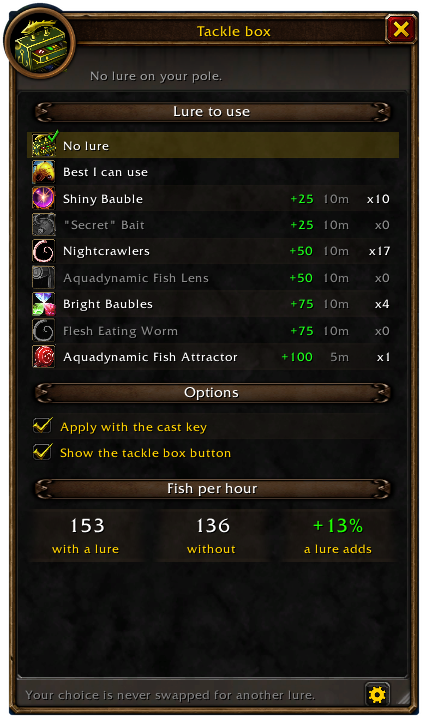
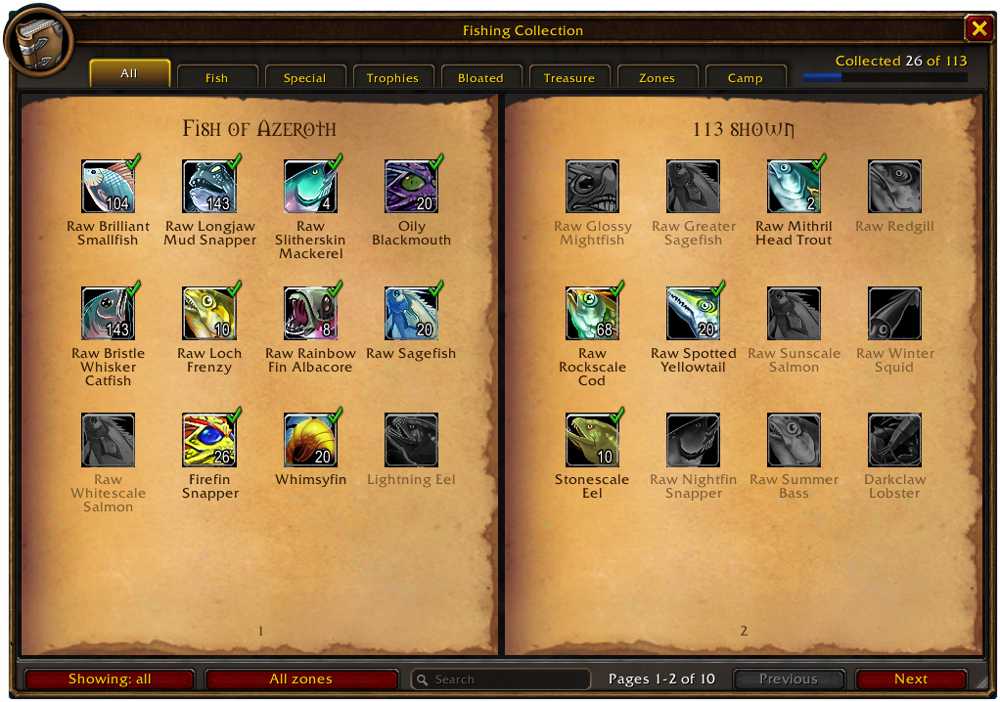
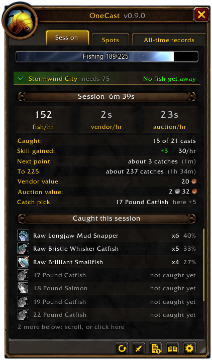
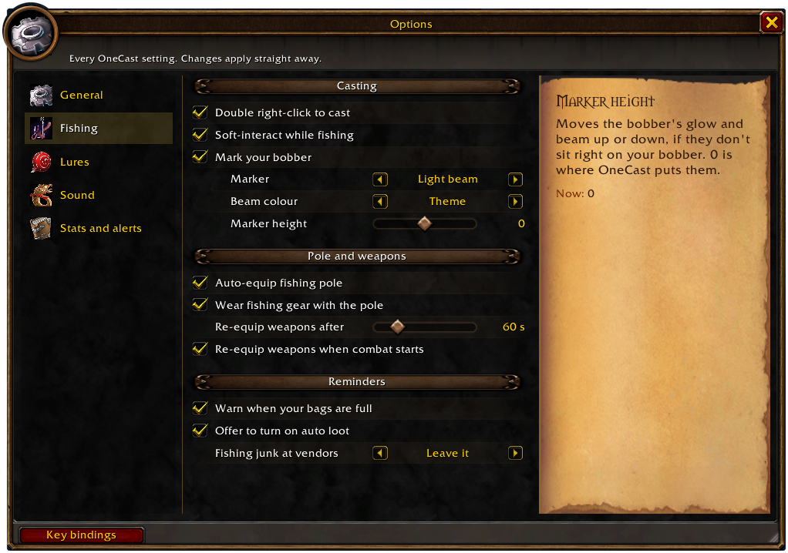
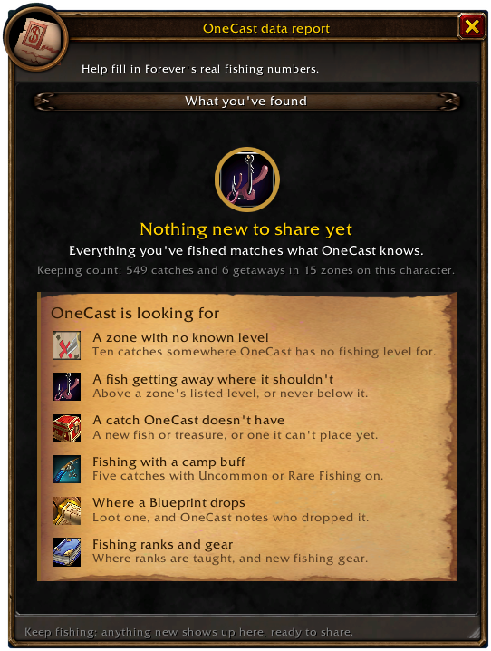

# OneCast

**One key to cast, the same key to reel.** OneCast turns fishing into a single button and adds everything around it: lures on your terms, a collection book of every fish in WoW Forever, fishing levels for every zone, and stats that show what your time on the water is worth.

Every cast, reel and lure is still your own press. OneCast never fishes for you.

## Getting started
1. Install, then bind a key under **Options → Keybindings → AddOns → OneCast** (or in OneCast's own options).
2. Stand by the water and press it to cast. With no pole equipped, the first press puts one on for you and the next one casts.
3. Press it again when the bobber splashes to reel in.

Prefer the mouse? **Double right-click** the water with a pole equipped to cast, and right-click the bobber to reel.

## Features

### 🎣 One-button fishing
- One key casts, then the same key reels in your bobber using the game's soft-interact.
- Optionally, **mark your bobber** with the game's gear icon while the line is out, so you can tell your splash from other people's.
- With no pole on, the key equips the best one in your bags.
- Your weapons are remembered and put back after a break (you choose how long), when combat starts, or with one click.
- Your keys go straight back to normal when the line comes in or combat starts.
- Warns you when you cast with full bags, and offers to turn on auto loot if it's off.

### 🧰 The tackle box

- A small button appears while your pole is on, showing your lure, how many you have and the time left. It pulses when the lure is about to run out.
- **You choose the lure** for each character, so a rare one is only spent if you pick it. Your choice is never swapped for another, or pick **Best I can use** if you don't mind spending them.
- Left-click to apply, use the Apply lure key, or turn on **Apply with the cast key** so your key applies the lure, then casts on the next press.
- Compare your **fish per hour with and without a lure**.
- Get a nudge at a vendor selling your lure when you have fewer than 5.

### 📖 The fishing collection

- A book of **every fish in WoW Forever**, and the **treasure** you can fish up: 109 catches across fish, special catches, trophy fish, bloated fish and treasure like **The 1 Ring** and the **Rumsey Rums**, shared across all your characters, including what you caught before installing.
- **How rare is it?** Every catch has a rarity, from Common to Very rare, with its odds: The 1 Ring is about 1 in 2,000 catches. Each zone on its page shows its own odds. These are Classic's odds, as Forever's aren't published.
- **Who caught it:** anything in the collection says on its tooltip how rare it is and which of your characters caught it, in your bags, chat links or the auction house.
- Click any fish for **its own page**: the game's description, your catches on every character, when and where you first caught it, whether it was **by day or at night**, every zone it's caught in with a **map**, and the **recipes** it's used in.
- **Wowhead links everywhere:** right-click any catch for its menu, or any reagent or recipe in the book, or use the Wowhead button on its page, for its WoW Forever page ready to copy.
- **Filter by zone and search by name.** Pick your zone and show what's missing, or just the rare catches (marked with a gem), to see what's left to catch here.
- Catch a fish none of your characters has and chat tells you it's **new for your collection**.
- **Remembered pools:** hover over a fishing pool with your pole on and cast, and the spot you fished it from is marked on the book's zone maps.

### 🗺️ Where to fish next

- **Zones tab:** every zone's fishing level at a glance, checked against your skill, with how many of its fish you've caught. Click a zone to see its fish.
- **Is this zone right for you?** A skill bar shows your Fishing skill, lure bonus included, and whether fish will get away here.
- Short of a zone's level? OneCast names a lure in your bags that would cover it.
- Zones without a known level are judged from your own catches and getaways. A getaway can also flag a listed level as too low, and 10 catches in a row clear it again.

### 📊 Session stats

A stats window that opens as you cast, with three tabs:
- **Session:** this session's catches, **fish per hour** and **gold per hour**. Also your skill gained and how fast, and about how long until the next point and your rank's cap. The catch list shows each fish's share, then the zone's fish you haven't caught yet.
- **Spots:** is this zone worth it? Its fish and gold per hour and every lake, coast and river you've fished here, best first. Click one for a waypoint. Pick a fish (or Ctrl-click one anywhere) to see where it bites best, how often you get it here, and when you last caught it.
- **All-time records:** personal bests (fish per hour, gold per hour, skill in a session, longest session), your notable catches (rares, wanted fish and new ones for your collection) and lifetime totals.

- A **session summary** in chat when you take a break.
- Click any catch to open it in the collection. **Right-click** for everything else: where it bites best, mark it as wanted, its **WoW Forever Wowhead** page or a chat link. The same clicks work in the collection.
- Long lists scroll with the mouse wheel.

### 💰 What your catch is worth
- Vendor value of everything caught, and per hour of fishing.
- Auction value with **Auctionator** or **TradeSkillMaster**. Open the auction house and scan your whole catch with Auctionator in one click.

### ✨ Rare catch alerts
- A raid-warning flash and sound for anything green or better (you choose the quality).
- Right-click any fish and choose **Mark as wanted** to get alerted when you catch it.

### 🏕️ Fishing at camp

- A **Camp tab** in the collection book for Forever's fishing crafts: the **Fish Bowl**, **Fishing Rack** and **Fishing Hut**, with the Fishing each needs, whether you've learned it, your reagents and what it does.
- The stats window shows the **Uncommon or Rare Fishing** buff from a Rack or Hut with its time left, and chat tells you when it wears off.
- What you catch while a camp buff is on is kept, to show what its extra rewards really are.

### 🏆 Fishing Extravaganza
- A countdown to Stranglethorn's Sunday contest, a Tastyfish counter while it runs, and an alert the moment you hold 40.
- Chat reminders shortly before it starts and when it does.

### 🔊 Hear the splash
- Sound effects turn up while your line is out.
- Optionally, music, ambience and dialog go quiet or off while your pole is equipped. Your own levels come back when your weapons go back on.

### ⚙️ Fits right in

- Built from WoW Forever's own UI style, with thirteen more themes if you'd like a change, from a wood-panelled **Fisherman's Lodge** and **Booty Bay** to **Murloc** and **Class Colours**.
- **One window for everything:** stats, tackle box, collection, Camp, data report, What's new and options, with side tabs to move between them (on the right or the left). Every page is the same height, and it opens wherever you last dragged it, on the page you had open after a `/reload`.
- **Every setting in the window:** the Options tab has them all, in the same order as the game's options, with sliders and choices right there.
- Minimap button and addon compartment entry.
- Scale the whole window (drag any page's corner, Ctrl + mouse wheel, or `/onecast scale`), or lock it in place.
- The stats open when you cast and close when your weapons go back on, and can fade while you fish.
- Green dots on the side tabs when you have something to share or a version to read.
- A **What's new** page shows every update.

## Opening things
- **The OneCast window:** left-click the minimap button for a menu of every page, use the side tabs, or the OneCast window key binding (it opens the page you last used).
- **Stats window:** opens when you cast, or right-click the minimap button.
- **Tackle box:** right-click its button, or `/onecast tackle`. Shift-drag the button to move it.
- **Fishing collection:** its side tab, the book button on the stats page, Shift-click the minimap button, or `/onecast book`.
- **Options:** the Options tab in the window has every setting (`/onecast` or the minimap button's menu opens it). Your cast key is set in the game's options: `/onecast keys`.
- **Key bindings:** cast and reel, Apply lure, Tackle box, Fishing collection, Re-equip weapons and the OneCast window (opens the page you last used), under Options → Keybindings → AddOns.

## Commands
| Command | What it does |
|---|---|
| `/onecast` | Open options |
| `/onecast keys` | The game's options, to set your cast key |
| `/onecast stats` | Show or hide the stats window (`/onecast session`, `spots` or `alltime` for a tab) |
| `/onecast tackle` | Tackle box settings |
| `/onecast tackle reset` | Move the tackle box button back to its first place |
| `/onecast book` | Fishing collection |
| `/onecast camp` | The collection's Camp tab |
| `/onecast report` | Your fishing data as text, to share |
| `/onecast theme` | Switch window theme (or `/onecast theme dark`) |
| `/onecast reset` | Start a new session |
| `/onecast gear` | Put your weapons back on |
| `/onecast scan` | Price your catch with Auctionator (auction house open) |
| `/onecast forgetpools` | Clear remembered pools |
| `/onecast new` | What's new |
| `/onecast help` | All commands and options |

## Good to know
- **Made for WoW Forever.** Classic Era and Retail aren't supported.
- The collection's fish and recipes are checked against WoW Forever's own game data. Where each fish is caught comes from Wowhead's WoW Forever data (Classic's catches with Forever's own added, including Zephras Isle and Riverglades), Classic data and player reports, marked as such. Fish with no known waters fill in from your own catches.
- **Zone fishing levels come from Classic data**, including dungeons and lakes with a level of their own, and Forever may differ. Its new zones have no data yet, so OneCast also counts real getaways to keep you honest.
- Lures work with a pole in your main hand, and take 5 seconds to apply. WoW only lets addons use items on your own press, so a lure can't go on by itself the moment you equip the pole.
- OneCast's own text is in English. Zone levels work in every client language, but pool marks only recognise English pool names for now.
- Pools move, so a mark shows where one has been, not where one is now.
- Auction values need Auctionator or TradeSkillMaster installed.

## Help fill in Forever's numbers

Nobody has published Forever's real zone fishing levels, or where its rarer fish are found. Type `/onecast report`, click **Select report**, press Ctrl+C and paste it in a comment here or in a [data report on GitHub](https://github.com/rynmon/OneCast/issues/new?template=data-report.yml). The report window has both links ready to copy. OneCast tells you when your fishing has turned up something it doesn't know, and the minimap button counts it until you share. It lists your catches and getaways with the skill each happened at, any fish the collection is missing, and nothing about who you are. With enough reports, OneCast can swap Classic's numbers for Forever's own.

## Feedback
Feature requests and bug reports are very welcome. Leave a comment or open an issue here on CurseForge. The Zones tab and the tackle box both started as comments there, so thank you to everyone who suggests something!

---

Working on OneCast itself? See [DEVELOPMENT.md](DEVELOPMENT.md) for how it works and how releases are built.
