# OneCast

**One key to cast, the same key to reel.** OneCast turns fishing in WoW Forever into a single button, on keyboard, mouse or controller, and adds everything around it: a beam of light on your bobber, lures on your terms, a fishing outfit that goes on with your pole, a collection book of every fish and treasure, every rank from Apprentice to Artisan, fishing levels for every zone, Forever's camp crafts, 33 window themes, and stats that show what your time on the water is worth.

Every cast, reel and lure is still your own press. OneCast never fishes for you.

## Getting started
1. Log in. A small welcome window asks for your cast key: click the button and press the key you want. (Change it any time at the top of **Options → Fishing**, or with `/onecast setup`.)
2. Stand by the water and press it to cast. With no pole on, the first press puts one on for you and the next one casts.
3. Press it again when the bobber splashes to reel in.

**Prefer the mouse?** Double right-click the water with a pole equipped to cast, and right-click the bobber to reel.

**Playing on a controller?** With your pole on, **A / Cross** casts and reels. Hold both triggers and press it to put the pole on first. **Y / Triangle** opens the OneCast window. Both buttons can be changed in **Options → Controller**.

## Features

### 🎣 One-button fishing
- One key casts, then the same key reels in your bobber using the game's soft-interact.
- With no pole on, the key equips the best one in your bags.
- Your weapons are remembered and put back after a break (you choose how long), when combat starts, or with **Done fishing**.
- Your keys go straight back to normal when the line comes in or combat starts.
- **Auto loot while fishing:** auto loot comes on with your pole and goes back to how you had it after.
- **Fast loot:** takes the whole catch the moment the loot window opens, quicker than the game's own auto loot. Only fishing loot and what's inside the trunks and crates you fish up.
- Warns you when you cast with full bags.

### 🎮 Controller support
- A **fishing button** that casts and reels while your pole is on, and goes back to normal the moment the pole comes off or combat starts.
- **Window navigation:** in Forever's gamepad interface, OneCast's windows join the game's own. The D-pad moves, A presses and B closes, side tabs included.
- Your controller's own **button icons**, at a size you choose, and **rumble** with rare-catch alerts.
- Works in Forever's gamepad interface and with a gamepad on in the standard one (ConsolePort and the like).

### 📊 Session stats
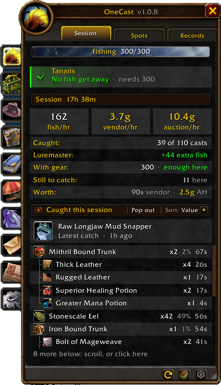

A stats window that opens as you cast, with three tabs:
- **Session:** fish per hour against your best, gold per hour, how many got away, what's **new for your collection**, your skill gained and how long until the next point. Each catch shows what it's worth.
- **Spots:** is this zone worth it? Its fish and gold per hour and every lake, coast and river you've fished here, best first. Click one for a waypoint. Pick a fish (or Ctrl-click one anywhere) to see where it bites best and when you last caught it.
- **Records:** personal bests, your notable catches (rares, wanted fish and new ones for your collection), lifetime totals and every past session.

And around it:
- **What was inside:** open a trunk, crate or clam you fished up and its contents are counted, valued and drawn under it as a tree.
- **Skill-ups:** +1 Fishing pops up on screen as your skill rises.
- **Your wanted list:** right-click a catch to add it, for an alert when you catch it. Or want a number of them, like 20 Stonescale Eels, with progress on its row.
- The session carries on through breaks, `/reload` and weapon swaps until you press **Reset**, or starts a new one by itself if you'd rather: after a break of the length you choose, each time you log in, each new day, or when you press Done fishing. The one before goes into your session history.
- Click any catch to open it in the collection. **Right-click** for your wanted list, where it bites best, its **Wowhead** page or a chat link.
- **More of the list:** click the **+** on the "Caught this session" header to fold the summary away, so the list fills the window.
- **Catch window:** **Pop out** puts this session's catch in a small window of its own to keep beside you while you fish. Drag it anywhere and pull its corner for more rows.
- **Your skill, piece by piece:** hover the Fishing bar to see each piece of gear, your fishing line, lure and food, and the total.

**Mini mode:** a slim bar in place of the stats while you fish, with your skill, the zone, your catch rate, lure and wanted list.

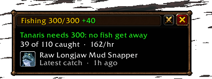

### 🧰 The tackle box
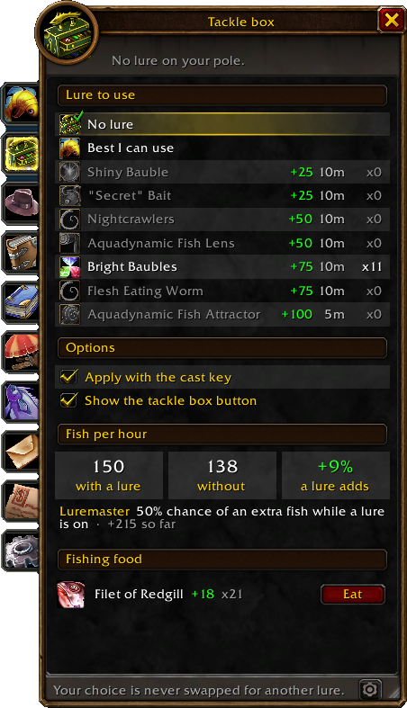

- A small button appears while your pole is on, showing your lure, how many you have and the time left. It pulses when the lure is about to run out.
- **You choose the lure** for each character, so a rare one is only spent if you pick it. Or pick **Best I can use** if you don't mind spending them.
- Left-click to apply, use the Apply lure key, or turn on **Apply with the cast key** so your key applies the lure, then casts on the next press.
- Compare your **fish per hour with and without a lure**.
- A nudge at a vendor selling your lure when you have fewer than 5.
- **Luremaster:** WoW Forever's Legacy tree talent gives up to a 50% chance of an extra fish while a lure is on. OneCast counts the extra fish it gives you, shows its chance in the tackle box, and tells you once when your lure runs out.
- **Fishing food:** some of Forever's cooked fish (Rockscale Cod, Filet of Redgill and more) make you Well Fed with up to +18 Fishing for 15 minutes. The tackle box shows the buff's time left and has a button to eat the best you have, chat reminds you when it wears off, and a zone you're just short for names the food that would cover it.

### 🌟 Your bobber, marked
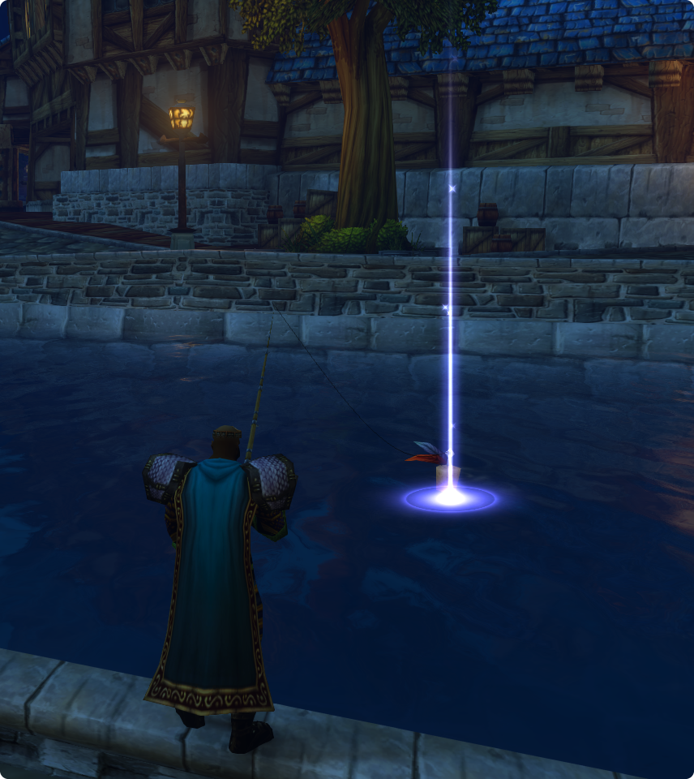

- Turn on **Mark your bobber** and a **column of light** rises from it, with a glowing ring on the water, so you can tell your splash from everyone else's.
- Pick its colour (arcane, gold, ice blue, your class colour and more, or any colour you like), the glow alone or the game's gear icon instead, and raise or lower it to sit right on your bobber.

### 📖 The fishing collection
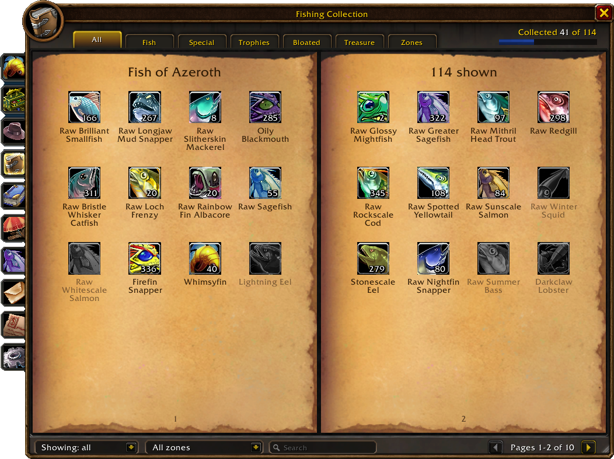

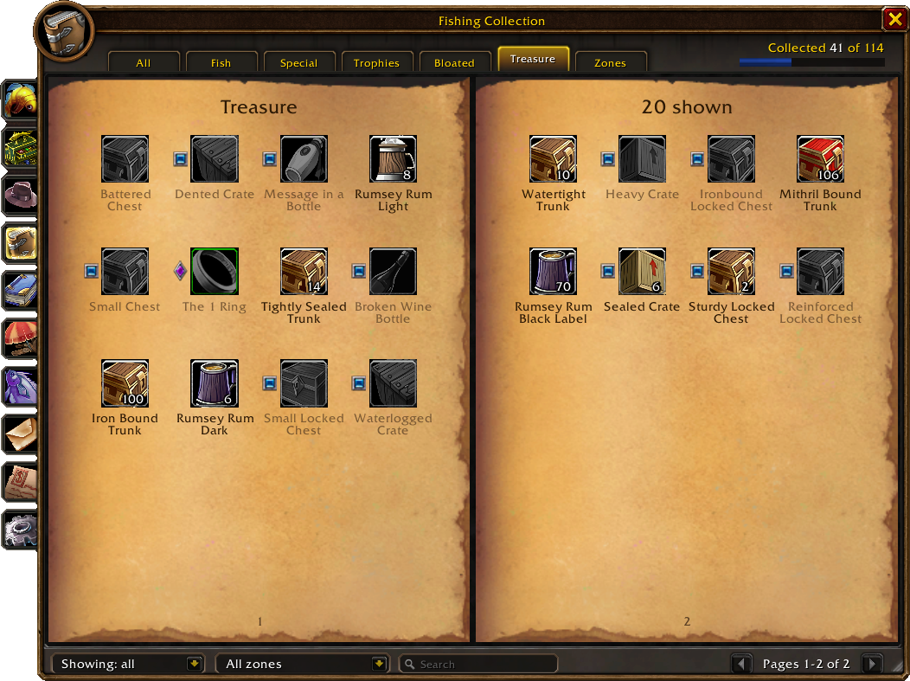

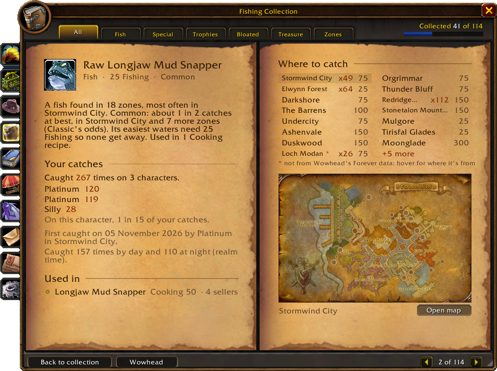

- **Every fish in WoW Forever** and the **treasure** you can fish up: 114 catches across fish, special catches, trophy fish, bloated fish and treasure like **The 1 Ring** and the **Rumsey Rums**. Shared across all your characters, including what you caught before installing.
- **How rare is it?** Every catch has a rarity, from Common to Very rare, with its odds (The 1 Ring is about 1 in 2,000 catches), zone by zone.
- **Who caught it:** a catch's tooltip says how rare it is and which of your characters caught it, in your bags, chat links or the auction house.
- **Its own page:** your catches on every character, when and where you first caught it, every zone it's caught in on a **map**, and the **recipes** it's used in, with who sells each recipe and a waypoint to the nearest seller.
- **Search everything:** catches, zones, pools, recipes, gear, ranks and settings, from the collection's search box or `/onecast search`.
- **Filter by zone:** show what's missing, what's **in reach** of your skill, or just the rare catches.
- Catch something none of your characters has and chat tells you it's **new for your collection**.
- **What's in a pool:** hover a fishing pool and its tooltip lists what it gives, and what you haven't caught yet.
- **Remembered pools:** cast at a pool and the spot is marked on the book's zone maps.

### 🗺️ Where to fish next
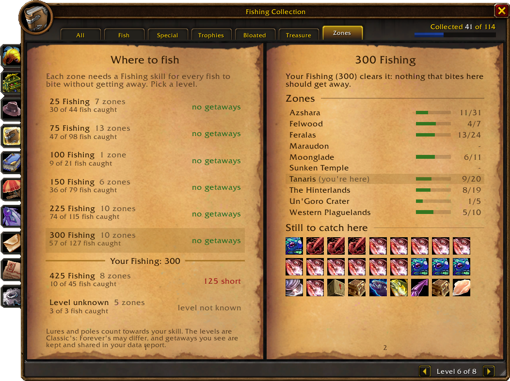

- **Zones tab:** a ladder of every zone by the Fishing it needs, with your skill marked on it and how many of each rung's fish you've caught. Click a zone to see its fish.
- **Is this zone right for you?** A skill bar shows your Fishing, with your gear, lure and food included, and whether fish will get away here. Short of a zone's level? OneCast names a lure in your bags that would cover it.
- Zones without a known level are judged from your own catches and getaways.
- **On the world map:** a zone's fishing level, how your skill stands and your fish caught there, on a card you can drag anywhere and size with Ctrl + mouse wheel.

### 💰 What your catch is worth
- Vendor value of everything caught, and per hour of fishing, counting what was inside the trunks and crates you opened.
- **Sell your fishing junk** at a vendor in one click, or automatically: only the grey items you fished up.
- Auction value with **Auctionator**, **TradeSkillMaster** or **Naowh Forever**, and with more than one installed, choose whose prices to use. Open the auction house and scan your whole catch with Auctionator in one click.

### ✨ Rare catch alerts
- A raid-warning flash and sound for anything green or better (you choose the quality).
- Fish on your wanted list get their own alert.

### 👒 The fishing wardrobe
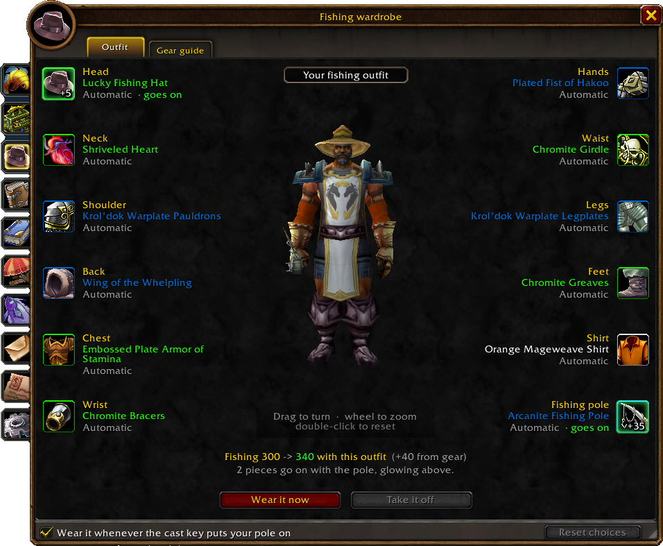

- Choose what you fish in, slot by slot, on a page laid out like the character sheet, with your character wearing it.
- Each slot takes the best Fishing bonus in your bags, an item you pick, or what you're wearing. Pick the pole too.
- See your Fishing with the outfit against what you wear now.
- It goes on with the pole and comes off with your weapons.

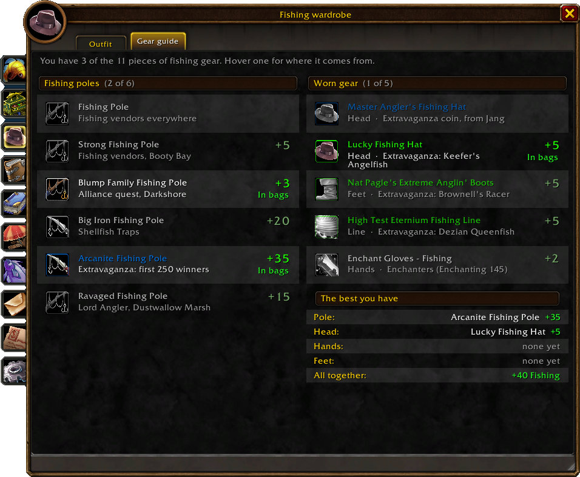

- **Gear guide:** every fishing pole and piece of fishing gear, with its Fishing bonus, whether you have it, and where it comes from. Click a card for a **waypoint** to where you get it: the quest giver, the rare that drops it, Booty Bay's prize vendors, or the nearest fishing vendor on your side. Right-click for its Wowhead page and its source's. Gear only the other faction can get is left out.

### 🧭 Fisherman's journey
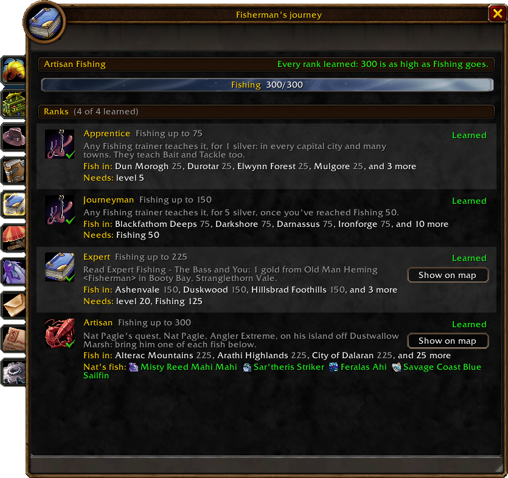

- The four Fishing ranks, Apprentice to Artisan: where you stand and how many catches to your cap, and for each rank how and where to learn it and where to fish at that stage.
- **Show on map** sets a waypoint to Expert's book in Booty Bay and to Nat Pagle for the Artisan quest. Nat's four fish tick off as you catch them.

### 🏕️ Fishing at camp
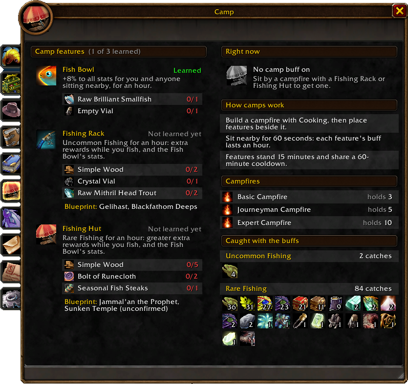

- A **Camp page** for Forever's fishing crafts: the **Fish Bowl**, **Fishing Rack** and **Fishing Hut**, with what each does, whether you've learned it, and your reagents against what it takes.
- **Where the blueprints drop**, with a click for a waypoint to the dungeon's entrance.
- The Fishing Rack's **Camper's Lure** (+60 Fishing for 5 minutes) is one of the tackle box's lures, so the cast key can put it on.
- The **campfires**, how many features each holds, and where the Journeyman and Expert blueprints come from.
- The **Uncommon or Rare Fishing** buff from a Rack or Hut shows with its time left, and chat tells you when it wears off. What you catch while it's on is kept, to show what its extra rewards really are: Rare Fishing brings up ore, metal bars, herbs, hides and Dream Dust beside the fish, and more trunks.

### 🏆 Fishing Extravaganza
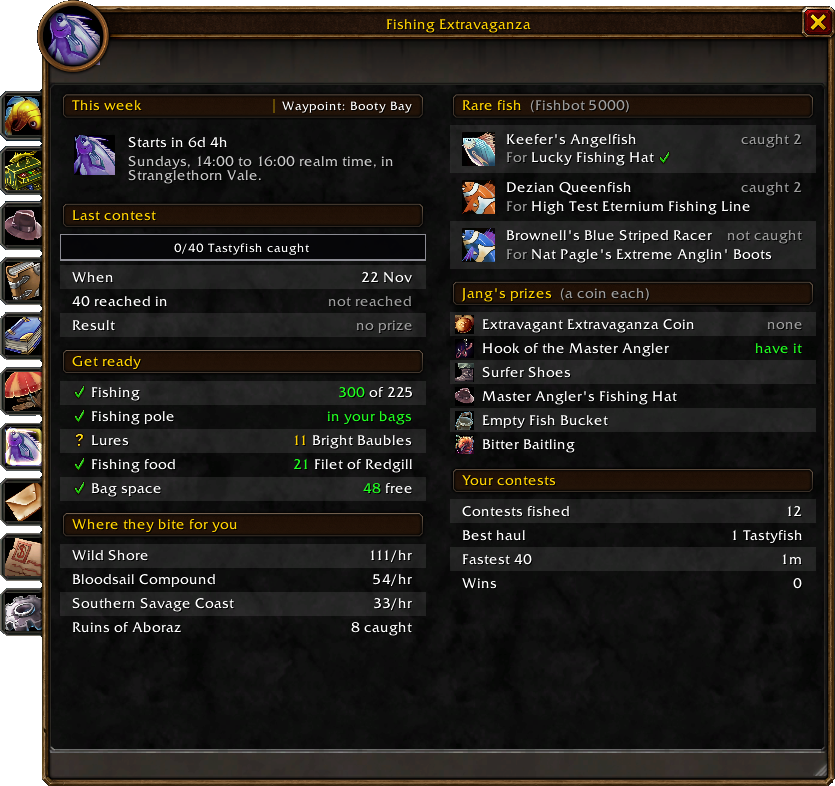

- Its own page: a countdown, the race, a checklist, the rare fish and prizes, and your records.
- **The race:** your Tastyfish, your pace, and whether 40 will come before the end, in the mini bar and stats window too. An alert and a waypoint to Riggle Bassbait the moment you hold 40.
- **Get ready:** an hour before, chat says what's missing: Fishing for Stranglethorn, a pole, lures, food, bag space.
- **Where they bite for you:** your best Stranglethorn spots for Tastyfish, from your own catches.
- **Prizes:** the first 250 winners get the Arcanite Fishing Pole and a coin for one of Jang's prizes. The page shows which of Jang's and Fishbot 5000's prizes you have.
- **Your results:** a summary when it ends, your best haul, fastest 40 and wins. Your win is spotted when you hand in.

### 🎨 Themes
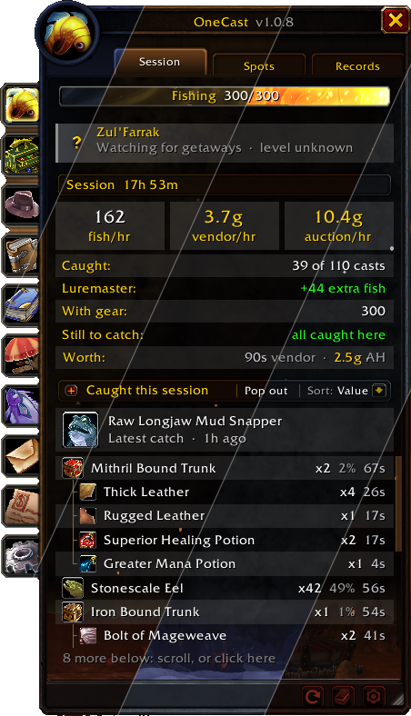

- **33 themes** recolour every OneCast window, the collection book's pages included. Pick one in **Options → Look**, or step through them with `/onecast theme` (or name one: `/onecast theme voldun`).
- Each is a place, not just a palette: its own **scenery** along the foot of each window, **particles** drifting over it (bubbles, snow, rain, embers, fireflies, falling leaves), an **emblem** in the title bar, and its own **water** in the Fishing bar.
- **Forever**, the default, is the game's own look. **Theme effects** keeps everything (Full), stills the particles (Still), or leaves only the colours. **Reduce motion** stills them too.

| | Themes |
|---|---|
| **The game's own** | Forever, Dark, Class Colours |
| **On the water** | Tidal, Abyss, Murloc, Darkshore, Stormsong |
| **Around Azeroth** | Ashenvale, Azshara, Durotar, Silverpine, Hillsbrad, Marsh, Winterspring, Booty Bay, Golden Hour, Moonlit, Fisherman's Lodge, Deviate, Ember |
| **Further afield** | Zuldazar, Vol'dun, Drustvar, Suramar, Shadowmoon, Fel, Mechagon, Bastion, Revendreth, Ardenweald |
| **Your side** | Alliance, Horde |

### 🌅 Just you and the water
- Turn on **Hide the game's interface while fishing** and, while your line is out, the interface fades away, leaving the water, your bobber and OneCast's own windows (Done fishing included).
- It comes back the moment the pole comes off, combat starts, you move or a window opens. Keys and bindings work as ever.

### 🔊 Hear the splash
- Sound effects turn up while your line is out.
- Optionally, music, ambience and dialog go quiet while your pole is on, and come back when your weapons do.

### ♿ Accessibility
- **Larger text** across every window.
- **Row shading:** every other row of a list shaded, light or strong, to follow a row across.
- **Controller button size:** normal, large or largest.
- Turn off the **ticks** on what you've caught, or **reduce motion** to stop OneCast's animations.

### ⚙️ Fits right in
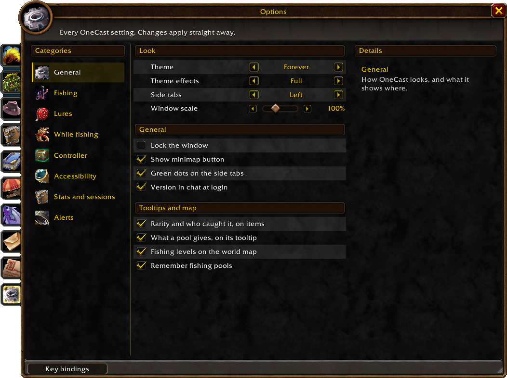

- Built from WoW Forever's own art and UI style, so it looks like part of the game.
- **One window for everything:** stats, tackle box, wardrobe, collection, Camp, Fisherman's journey, the Extravaganza, feedback, What's new and options, with side tabs to move between them. It opens wherever you last dragged it, on the page you had open.
- **Every setting in the window,** a category at a time, with each one explained beside it as you hover.
- **Stays open while you need it:** Escape is left to the game's menu and windows, and Done fishing leaves the stats up. Either can close OneCast instead, if you'd rather (**Options → Stats and sessions**).
- Scale the whole window (drag a corner, Ctrl + mouse wheel, or `/onecast scale`), or lock it in place.
- Minimap button and addon compartment entry.
- A **What's new** page shows every update.

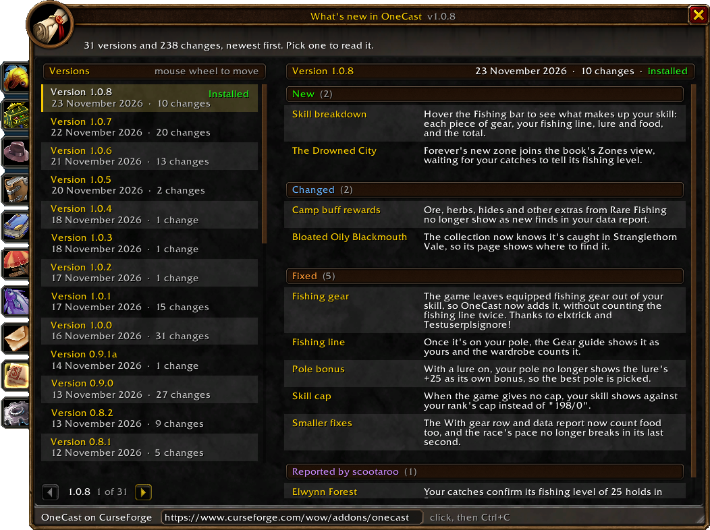

## Opening things
- **The OneCast window:** left-click the minimap button for a menu of every page, use the side tabs, or the OneCast window key binding.
- **Stats window:** opens when you cast, or right-click the minimap button.
- **Tackle box:** right-click its button, or `/onecast tackle`. Shift-drag the button to move it.
- **Catch window:** Pop out on the stats window's list, the **Catch window** setting (Options → Stats and sessions), or `/onecast catches`.
- **Fishing collection:** its side tab, the book button on the stats page, Shift-click the minimap button, or `/onecast book`.
- **Options:** the Options tab in the window, or `/onecast`.
- **Key bindings:** cast and reel, Apply lure, Tackle box, Fishing collection, Fishing wardrobe, Fisherman's journey, Re-equip weapons, Done fishing and the OneCast window, under Options → Keybindings → OneCast.

## Commands
| Command | What it does |
|---|---|
| `/onecast` | Open options |
| `/onecast setup` | Choose your cast key |
| `/onecast stats` | Show or hide the stats window (`/onecast session`, `spots` or `alltime` for a tab) |
| `/onecast search <words>` | Search catches, zones, recipes, gear, ranks and settings |
| `/onecast book` | Fishing collection (`/onecast camp` for the Camp page) |
| `/onecast tackle` | Tackle box |
| `/onecast wardrobe` | Choose what you wear to fish |
| `/onecast journey` | The Fishing ranks, and where to learn the next |
| `/onecast done` | Done fishing: weapons and gear back on |
| `/onecast reset` | Start a new session |
| `/onecast contest` | The Fishing Extravaganza page |
| `/onecast riggle` | A waypoint to Riggle Bassbait, for the Fishing Extravaganza |
| `/onecast catches` | Show or hide the catch window |
| `/onecast theme [name]` | Change the window theme (no name: the next one) |
| `/onecast scan` | Price your catch with Auctionator (auction house open) |
| `/onecast feedback` | Report a bug or suggest an idea |
| `/onecast report` | Your data report: fishing numbers to share, to help fill in Forever's |
| `/onecast pad` | What OneCast sees of your controller, if it isn't behaving |
| `/onecast new` | What's new |
| `/onecast help` | Every command, and a toggle for every setting |

## Good to know
- **Made for WoW Forever.** Classic Era and Retail aren't supported.
- The collection's fish, recipes, gear, lures and camp crafts are checked against WoW Forever's own game data and Wowhead's Forever database. Where each fish is caught comes from Wowhead's Forever data, Classic data and player reports, marked as such.
- **Zone fishing levels start from Classic data**, and players' data reports are confirming or correcting them for Forever zone by zone. Forever's new zones without a level yet are judged from your own catches and getaways.
- Forever leaves equipped fishing gear out of the Fishing number it reports (lures, food and enchants like the fishing line are in it), so OneCast adds your gear's own bonus, never twice.
- Lures work with a pole in your main hand, and take 5 seconds to apply. WoW only lets addons use items on your own press, so a lure can't go on by itself.
- OneCast's own text is in English. Zone levels, pool tooltips and the fishing outfit work in German, French, Spanish, Russian, Korean and Chinese clients too.
- Pools move, so a mark shows where one has been, not where one is now.
- Auction values need Auctionator, TradeSkillMaster or Naowh Forever installed.

## Feedback
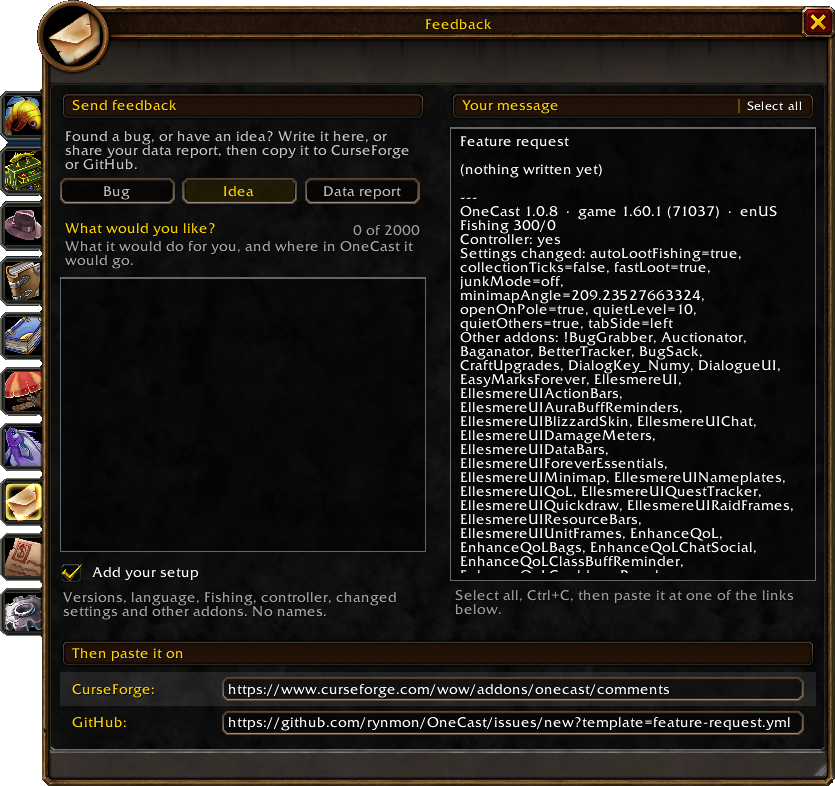

Found a bug, or have an idea? Open the **Feedback** tab (or type `/onecast feedback`), pick Bug or Idea and write it. OneCast can add your version and setup (no names), then you copy the text and paste it in a comment here or in a [GitHub issue](https://github.com/rynmon/OneCast/issues/new/choose). The Zones tab, the tackle box and much of 1.0 started as comments, so thank you to everyone who suggests something!

### Data report
Nobody has published Forever's real zone fishing levels or all of its loot, so OneCast learns them from players. Pick **Data report** on the Feedback tab (or type `/onecast report`) to see what you've found that OneCast doesn't know yet: a zone's real level, a fish or treasure that's new, what a camp buff brings in. A green dot on the tab says when there's something new. Copy the report and paste it in a comment or the [data report form](https://github.com/rynmon/OneCast/issues/new?template=data-report.yml): its last line, the report code, is all OneCast needs, so that line alone is enough. It holds fishing numbers only: no character name, realm or guild.

### The fishing atlas
Every report pasted in the comments goes into OneCast's **fishing atlas**, released with each update. A zone's tooltip says what players have seen there in Forever, like "Confirmed in Forever by 3 players' reports", and where Forever's own level turns out to differ from Classic's, OneCast uses Forever's. As reports with the code come in, a fish's page also shows how often it's really caught in each zone.

---

Working on OneCast itself? See [DEVELOPMENT.md](DEVELOPMENT.md) for how it works and how releases are built.
